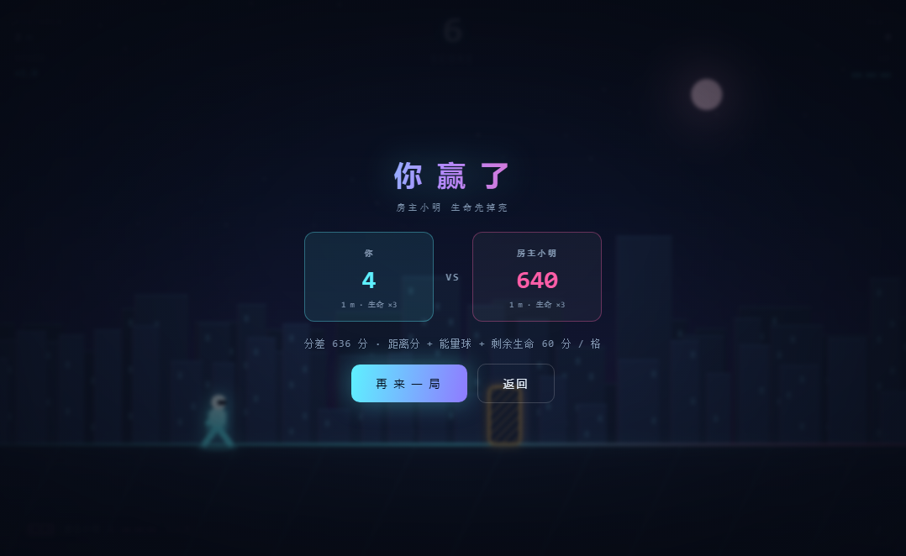
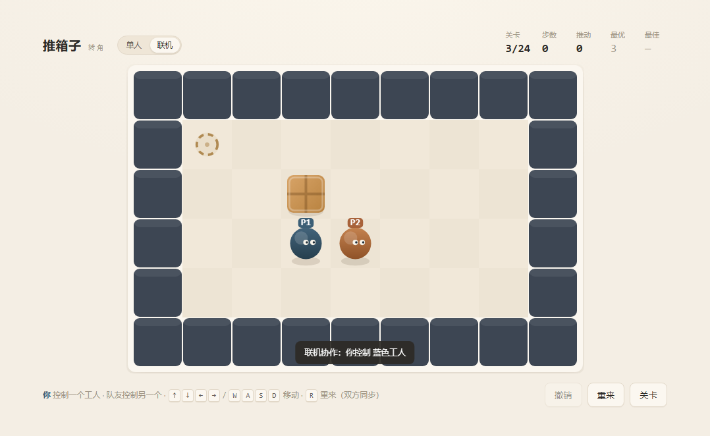

# 游戏架

两款纯前端游戏，**零依赖、零构建**，双击 HTML 就能玩，也可以用一条命令挂到内网给别人连。

**GitHub 仓库**：<https://github.com/cjh0509code-png/game>

| 霓虹疾走 · 联机结算 | 推箱子 · 联机协作 |
|---|---|
|  |  |

| | 类型 | 玩法 | 操作 | 单局时长 |
|---|---|---|---|---|
| **霓虹疾走** `games/neon-runner/` | 动作 · 无尽跑酷 | 躲障碍、吃能量，速度和障碍密度一路上升；**3 格生命，掉完才结束**（无时间限制），单人冲分或**联机对战** | `空格/↑/W` 跳 · `↓/S` 滑 | 30 秒 ~ 2 分钟 |
| **推箱子** `games/sokoban/` | 益智 · 关卡解谜 | 把箱子推到目标点，**24 关**逐步变难（最优推数 1 → 29）；支持**联机协作** | `方向键/WASD` 移动 · `Z` 撤销 · `R` 重来 · `Esc` 关卡表 | 每关 1~15 分钟 |

---

## 一、怎么玩

**从 GitHub 获取**：

```bash
git clone https://github.com/cjh0509code-png/game.git
cd game
```

仓库根目录就是本工程（原 `arcade/` 文件夹的内容），克隆下来即可运行，无需安装依赖。

**自己玩**：双击 `index.html` 打开游戏架，点进去就行（`file://` 直接可用，不依赖服务器）。

**给别人玩（同一内网）**：双击 `serve-games.bat`，命令行会打印地址：

```
本机访问:  http://localhost:8080
局域网:    http://172.16.30.141:8080   (WLANX)     ← 以命令行实际打印为准
```

把局域网地址发出去即可。首次运行若 Windows 弹防火墙提示，选「允许访问（专用网络）」。
端口被占用会自动顺延到 8081、8082…，以命令行打印的为准。

> 服务把本工程目录当作根目录，只对外暴露 `index.html`、`games/`、`shared/` 三处，
> 同级目录里的其它工程不会被暴露。

**放到公网（GitHub Pages）**：本工程是纯静态页面，在仓库 `Settings → Pages` 里选择 `main` 分支即可在线玩单人模式。
联机模式依赖 `server/serve.js` 的房间 API，静态托管不支持，需要在本地或任意 Node 环境运行。

---

## 二、霓虹疾走

### 单人

**没有时间上限，血掉完才结束。** 玩家有 3 格生命，撞一次掉一格并进入 1.1 秒无敌，
3 格掉完才结算——所以单局长度完全取决于你能撑多久，而不是倒计时。

难度不靠"调怪"，而由**警告时间**定义：障碍从进入屏幕到打到玩家要多久。

```
速度 = 0.76 × 画布宽 ÷ 警告时间
警告时间：开局 2.35 秒 → 75 秒内线性压到 0.95 秒
```

这样手机（390px 宽）和显示器（1200px 宽）**反应时间一致**，不会出现"手机上障碍贴脸"。
HUD 左上角的 `×1.0 → ×2.5` 就是当前速度倍率，会随时间一路涨上去。

| 参数 | 值 | 依据 |
|---|---|---|
| 重力 | 3.2 H/s² | H = 跑道高，下同 |
| 起跳速度 | 1.02 H/s | 跳跃高度 = v²/2g ≈ 0.163H |
| 二段跳 | 0.86 H/s | 弱于一段，够补一次失误 |
| 滞空时间 | 0.64 s | 2v/g |
| 站立高度 | 0.088 H | 会被横梁拦住 |
| 滑铲高度 | 0.046 H | 横梁下沿在 0.075H，能钻过去 |
| 障碍间隔 | 1.75~2.60 s（后期 0.95~1.25 s） | 落地后仍留 ≥0.3 s 再起跳 |

障碍四类：地刺（跳）、高块（跳）、悬挂横梁（滑铲）、低空无人机（滑铲）。

**障碍会越来越多**，两条曲线叠加：

| 时间 | 平均每组障碍数 | 平均间隔 |
|---|---|---|
| 0~10 s | 1.0 | 2.17 s |
| 22~38 s | 1.31 | 1.63 s |
| 58 s 后 | 1.6~1.7 | 1.10 s |

后期会成组出现（2~3 个连排）。**组内只用同一种应对方式**：跳类（地刺/高块）或
滑类（横梁/无人机），绝不会出现"要同时跳又得滑"的无解组合。

组的宽度还受一道闸限制：`(一次跳跃/滑铲覆盖距离 − 玩家自身宽度) × 0.72(跳) / 0.85(滑)`。
不设这道闸，窄屏（模型大、速度慢）会生成物理上跳不过去的连排——手机竖屏尤其明显。

### 联机对战

房间规则对所有游戏通用，实现在 `server/serve.js`（服务端）和 `shared/room.js`（客户端，自带界面）：

- **第一个进房间的人是房主**，其他人进来点「准备」，房主点「开始游戏」。
- 房主点开始后服务端给出 3 秒倒计时，**所有人同一时刻出发**。
- 双方拿到**同一个随机种子**，障碍剧本逐组一致；屏幕宽度只影响像素位置，不影响难度。
- 谁先掉完 3 格生命谁出局，**由服务端裁定并广播**，两边看到同一份结果，不会各算各的。
- 中途关页面或退出按弃权处理，对面直接获胜。
- 结算后房主可以「再来一局」，其他人回到房间重新准备。

每个玩家各 3 格生命：

- **撞一次掉一格生命**，并进入 1.1 秒无敌（闪烁），不会连续掉光。
- **谁先掉完生命谁出局，对局立刻结束**——没有加时，也没有时间上限。
- 分数 = 距离分 + 能量球 ×18 + 剩余生命 ×60。

分数公式与画布尺寸无关（按"横穿多少屏"折算米数），所以手机和显示器上的分数可比。

### 其他

`localStorage` 里保存单人最高分（`neonrun.best.v2`）和静音开关（`neonrun.mute.v1`）。

---

## 三、推箱子

**单人 / 联机协作两种模式**，顶部随时切换。

| | 单人 | 联机协作 |
|---|---|---|
| 操作 | `方向键` 或 `WASD` 都能控制 | 每人只控制自己的工人，两套键位都能用 |
| 规则 | 一人推完所有箱子 | 两个工人一起推，谁都能推箱子 |
| 记录 | 写入"最优推数"记录 | **不写记录**，通关弹窗列出各自推了几次 |

联机时**整张棋盘是共享的**：谁推一步就把状态广播出去，对面立刻看到同一个箱子、同一个位置。
换关、重来由房主发起，全队同步；两个人各走各的会互相挡路。

> 联机时不能撤销（会和队友的状态打架），用「重来」把整局同步回起点。

关卡数据在 `games/sokoban/levels.js`，只有这一份，游戏和校验脚本共用。

```
# 墙    空格 地板    . 目标    $ 箱子    * 箱子在目标上    @ 玩家    + 玩家在目标上
```

**改完必须跑校验**（穷举验证每关真的有解，并算出最优推数）：

```
node tools/verify-levels.js
```

输出示例：

```
│ 23 │ '24. 双仓' │ '12×9' │ 3 │ 29 │ 29 │ 'PASS' │ '→↓↓↓↓→↓→→…' │ 27415 │
```

`par` 必须等于脚本算出的最优推数，不一致直接报错退出——
游戏里显示的"最优 N 推"不是拍脑袋写的，是 BFS 搜出来的。

24 关的最优推数：
`1 2 3 4 4 4 5 5 6 7 8 12 | 12 14 14 16 16 18 18 18 20 22 22 29`

竖线后面是后加的 12 关，箱子从 1~3 个增加到 3~4 个，需要规划推动顺序、穿过单格通道、
跨房间运输。全部由求解器证明可解。

### 关卡是怎么来的

`tools/gen-levels.js` 用**反向拉箱**生成：从"箱子全在目标上"的完成态出发，
随机做反向的"拉箱"操作，反向路径就是一条可行解，所以生成的关卡一定可解。
目标点集中在一小片区域，箱子被拉散到各处，正向就要跨半个房间运输。

```
node tools/gen-levels.js 10    # 生成 10 个候选并打印 par
```

生成器只负责出题，`par` 仍由求解器裁定。手写关卡同样走这套校验。

### 死锁提示

游戏内建角落死锁与贴墙死锁判定，箱子推到死角会提醒你按 `Z` 撤销。
求解器额外剪掉 **2×2 死锁**（四个格子被墙/箱子填满且其中有箱子不在目标上），
否则 4 箱关卡的状态空间会大到搜不完。

---

## 四、目录

```
game/                     GitHub 仓库根目录（原 arcade/ 的内容）
├─ index.html             游戏架（唯一总入口）
├─ serve-games.bat        一键挂到内网
├─ README.md              玩家说明
├─ AGENTS.md              工程规范（Codex / 唯一规则源）
├─ CLAUDE.md              Claude Code 规范入口
├─ games/                 所有游戏，一个游戏一个目录
│  ├─ neon-runner/
│  │  └─ index.html      跑酷（单文件，HTML+CSS+JS 全内联）
│  └─ sokoban/
│     ├─ index.html      推箱子（单文件）
│     └─ levels.js       关卡数据（游戏与校验脚本共用）
├─ shared/
│  └─ room.js            公用联机房间（所有游戏共用）
├─ server/
│  └─ serve.js           静态服务 + 房间 API（端口自动顺延 + 目录白名单）
└─ tools/                开发与自测脚本（不对外提供）
   ├─ solver.js          推箱子求解核心（BFS + 死锁剪枝）
   ├─ verify-levels.js   关卡校验：可解性 + 最优推数
   ├─ gen-levels.js      关卡生成（反向拉箱，保证可解）
   ├─ cdp-lib.js         Chrome CDP 自测工具
   ├─ test-room.js       房间流程自测（25 项）
   ├─ test-net.js        跑酷联机双端自测（16 项）
   └─ test-sokoban-net.js 推箱子联机自测（15 项）
```

两个游戏都是单文件、无外部资源、无 CDN，断网也能玩。
音效由 WebAudio 现场合成，没有音频文件。

开发 / 贡献规范见 [AGENTS.md](AGENTS.md)（Claude Code 见 [CLAUDE.md](CLAUDE.md)）。

---

## 五、已知取舍

- **联机只支持 2 人**：房间是双人位，跑酷对战和推箱子协作刚好两人，加人需要改房间上限和玩法。
- **联机的战况由客户端上报**：服务端只做汇总与裁定，不跑物理。内网自娱够用，
  真要防作弊得把模拟搬到服务端。
- **推箱子联机是"最后写入胜"**：两人同一瞬间操作可能短暂覆盖，局域网延迟下基本察觉不到。
- **推箱子联机没有"配合专属"的关卡**：任何一关两个人都能过（一人不动也能过），
  联机带来的是分工和互相挡路的乐趣，不是另一套关卡。
- **没有排行榜**：分数只在结算面板里，不落库。
- **跑酷只有键盘和触屏**：没做手柄支持；单人时手机上上半屏点跳、下半屏点滑。
- **推箱子撤销无次数限制**：熟人自娱够用，没做步数惩罚。
- **推箱子关卡全开放**：不做解锁限制，想跳关直接跳。
- **音效默认开**：跑酷右下角可静音，设置会记住。
